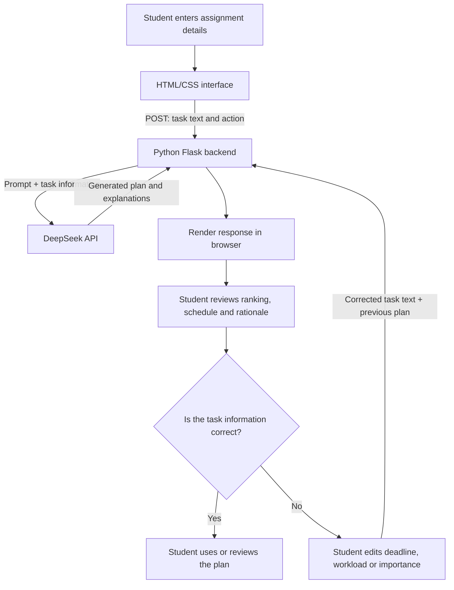
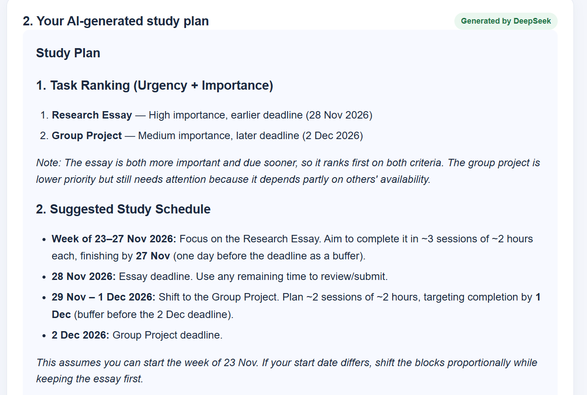
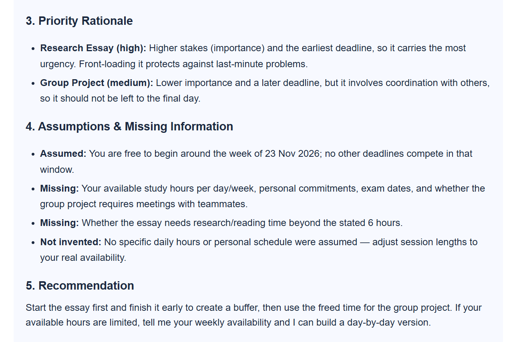
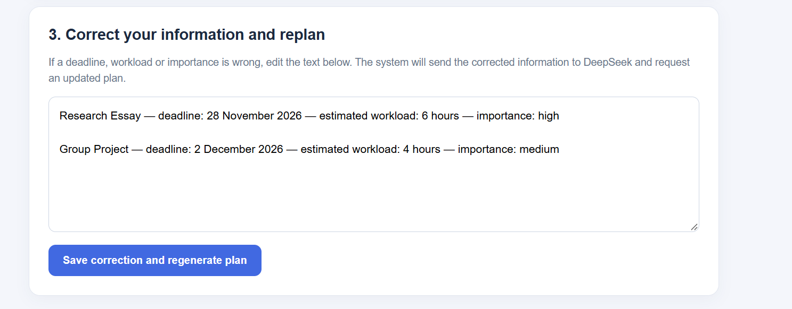
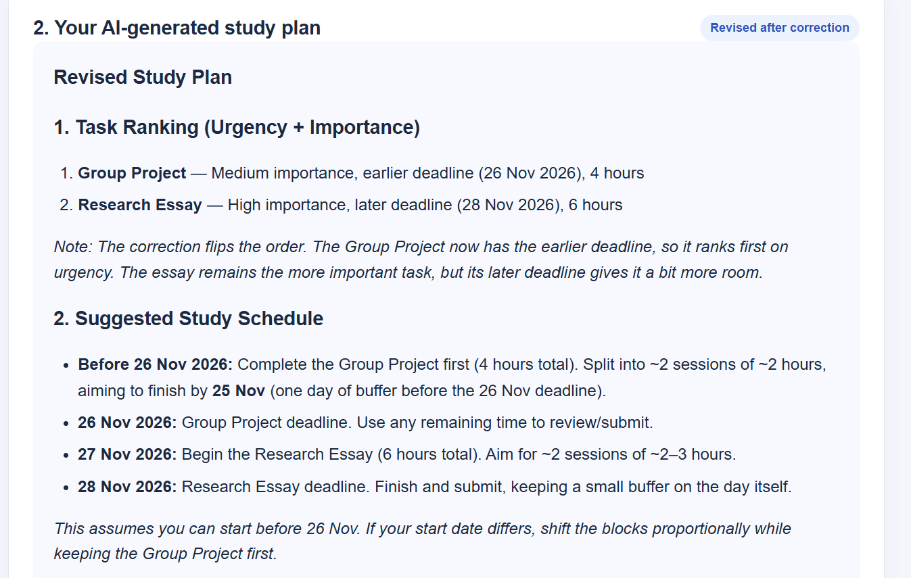
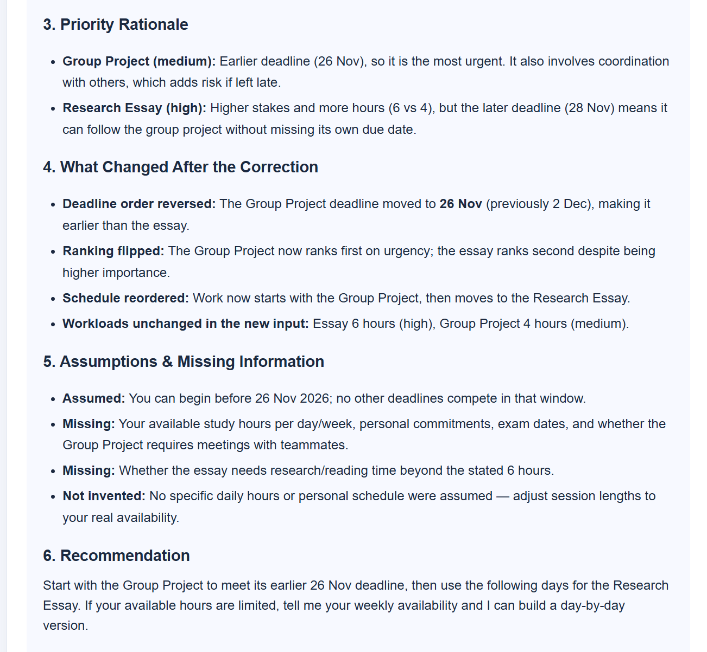

# StudyFlow AI Planner: An Explainable and User-controllable Study Planning Prototype

**Module:** Intelligent Interactive Systems  
**Assessment:** Assignment 2 – Project Report  
**Project status:** Working prototype with LLM-generated plans and a demonstrated correction/replanning interaction  
**Main report word count:** approximately 1,080 words (Abstract + Design Rationale; headings and references excluded)

## Abstract

University students often manage several assignments with different deadlines, workloads and levels of importance. Deciding what to work on first can be difficult, especially when deadlines change or information has been entered incorrectly. An AI-generated plan may help organise tasks, but an unexplained recommendation can be difficult for a student to evaluate or correct.

StudyFlow AI Planner is a web prototype that accepts assignment descriptions and uses the DeepSeek language-model API to generate a ranked study plan. It returns a suggested schedule, explains the reasons for task priorities and states assumptions or missing information. The user can then edit the assignment details and request a revised plan. In the demonstrated scenario, changing the Group Project deadline from 2 December to 26 November causes the revised response to rank it ahead of the Research Essay and explain the change.

The prototype uses an HTML/CSS interface, a Python Flask backend and the DeepSeek API. It explores visibility, feedback, user control and error recovery in a simple human–AI interaction. It does not yet save tasks between sessions, connect to a calendar or evaluate learning outcomes through a formal user study.

## Design Rationale and Project Explanation

### 1. Problem and project aim

Students may have to coordinate assignments that differ in deadline, workload and perceived importance. A simple task list records this information but does not necessarily help students decide what to do first. An AI assistant can generate a proposed order and schedule, but the student needs to understand the recommendation rather than accept it blindly. The system must also allow the student to correct information that the AI has been given.

The project follows the research question developed in Assignment 1: *How does explaining task priorities while allowing students to correct assumptions affect their understanding and ability to modify AI-generated learning plans?* The prototype operationalises this question through two connected design goals: provide reasons for task prioritisation, and let the user amend task information and obtain a revised recommendation.

### 2. Design decisions and interaction

The interface uses a text area in which the student enters each assignment with its name, deadline, estimated workload and importance. This was chosen as a deliberately lightweight input method: it avoids requiring an account, database or complex task-management workflow. The page then displays the AI-generated response in a separate result area.

The response is organised around task ranking, a suggested study schedule, priority rationale, assumptions and recommendations. Showing the rationale is important because a ranking alone does not reveal whether the model considered the deadline, workload or stated importance. In the first demonstrated example, the Research Essay is ranked first because it has the earlier deadline (28 November 2026), higher importance and a six-hour workload. The Group Project is ranked second with a 2 December deadline, medium importance and a four-hour workload.

A separate correction area appears after the first response. The student can edit the original assignment text and submit it with the previous plan. The backend sends both the corrected task information and previous plan to DeepSeek, asking it to recalculate the ranking, revise the schedule and identify what changed. In the demonstrated correction, the Group Project deadline is changed from 2 December to 26 November 2026. The revised response places the Group Project first because it is now due earlier, while retaining the Research Essay's higher importance. It also describes the deadline-order change, ranking change and schedule reordering. This is the central interaction evidence for user correction and recovery.

### 3. Human–AI interaction principles

The design applies several principles relevant to human–AI interaction. **Visibility** is supported by displaying the generated ranking, schedule, rationale and assumptions rather than returning an unexplained answer. **Feedback** is provided through the generated result and the revised-plan status after a correction. **User control** is supported by allowing the student to edit the task description instead of treating the first AI output as final. **Error recovery** is demonstrated when a changed deadline is resubmitted and the system produces a different ranking. The text input also supports **recognition rather than recall** to a limited extent by giving examples of the information to provide.

These features relate to the human–AI interaction guidance of Amershi et al. (2019), particularly communicating system behaviour and supporting users in correcting errors. They also reflect the human-centred explanation perspective discussed by Ehsan and Riedl (2020): explanations should help people interpret AI output in their own context. The prototype demonstrates these design intentions, but it does not establish through user testing that students' understanding or trust has improved.

### 4. System architecture and technical choices

The system has three main technical parts. The browser presents the HTML/CSS interface and submits form data to the Flask application. Flask receives the task description, constructs the prompt and sends a chat-completion request to the DeepSeek API using the OpenAI-compatible Python client. The model response is returned to Flask and rendered in the page. For a replanning request, Flask also passes the previous plan and the corrected task description so that the model can compare the two states.

This architecture was selected because it separates the user interface from API communication and keeps the API key on the server rather than exposing it in browser code. The key is loaded from a local `.env` file, which is excluded from version control. The prototype uses a language model to interpret the task description and produce natural-language recommendations; it does not use a deterministic scheduling algorithm or independently validate whether the proposed study sessions fit the student's real calendar.

### 5. Scope, limitations and future work

The implemented scope includes task entry, an initial DeepSeek-generated plan, explanations and assumptions, editing the task description, and requesting and displaying a revised plan. The submitted screenshots document the initial and corrected interaction. The prototype does not persist information after a session, parse task data into validated structured records, access calendar availability, or support multiple users. The model may misunderstand ambiguous input or propose a schedule that is impractical. The student therefore remains responsible for checking the output.

Future work could add structured task fields, explicit confirmation of extracted deadlines, persistent storage, calendar availability and a small usability evaluation. These are proposed extensions, not claims about the current implementation.

## System Diagram

The diagram distinguishes implemented components and the data flow. The correction loop is part of the current prototype.

*Figure 7. StudyFlow architecture and correction loop. All components shown are implemented in the current prototype; the diagram does not imply calendar integration or persistent storage.*

## Visual Evidence from the Working Prototype

The following figures are screenshots captured from the running prototype during the demonstrated interaction.

*Figure 1. The student enters assignment names, deadlines, estimated workloads and importance.*

*Figure 2. The first response ranks the Research Essay ahead of the Group Project and proposes a schedule.*

*Figure 3. The response explains the ranking and identifies assumptions and missing information.*

*Figure 4. The student can edit the assignment description after reviewing the first plan.*

*Figure 5. After the Group Project deadline is changed to 26 November 2026, it is ranked first.*

*Figure 6. The revised response explains the deadline-order change, ranking change and schedule reordering.*

## Storyboards and Illustrated Interaction

### Scenario 1 – Generate and understand a plan

1. The student enters two assignments and their deadlines, workloads and importance (Figure 1).
2. The student submits the form. StudyFlow sends the information to DeepSeek and displays a ranked plan and suggested schedule (Figures 2–3).
3. The student reads the rationale and assumptions to judge whether the recommendation makes sense.

### Scenario 2 – Correct an inaccurate deadline

1. After reviewing the first plan, the student notices that the Group Project deadline is incorrect.
2. The correction interface presents the assignment text for editing (Figure 4).
3. The student changes the deadline from 2 December to 26 November 2026 and selects “Save correction and regenerate plan”.

### Scenario 3 – Review the revised recommendation

1. Flask sends the corrected information and previous response to DeepSeek.
2. The revised plan ranks the Group Project first because its deadline is now earlier (Figure 5).
3. The response explains that the deadline order, task ranking and schedule have changed, while the original workload and importance values remain the same (Figure 6).
4. The student can review the revised recommendation and decide whether it is appropriate.

## Repository and Development Evidence

The repository contains the Flask application, HTML template, dependency list, environment-variable example, README, report and screenshots. The screenshots in `images/` document the initial task entry, generated plan, correction interface and revised plan. The current prototype was manually exercised with a two-assignment example and a changed deadline. This is functional demonstration evidence, not a formal user study.

**GitHub repository:** https://github.com/1239hhh/AI-Study-Planner  
**README:** https://github.com/1239hhh/AI-Study-Planner/blob/main/README.md  
**Development record:** See `README.md` in the repository.  
**Commit:** See the repository commit history for the submission version.

## References

Amershi, S. et al. (2019). Guidelines for Human-AI Interaction. *Proceedings of the 2019 CHI Conference on Human Factors in Computing Systems*. https://doi.org/10.1145/3290605.3300233

Ehsan, U. and Riedl, M. O. (2020). Human-centered explainable AI: Towards a reflective sociotechnical approach. *Human-Computer Interaction*, 2020. https://doi.org/10.1007/978-3-030-60117-1_33

Conati, C. et al. (2021). Toward personalized XAI: A case study in intelligent tutoring systems. *Artificial Intelligence*, 298, 103503. https://doi.org/10.1016/j.artint.2021.103503

Rong, Y. et al. (2024). Towards human-centered explainable AI: A survey of user studies for model explanations. *IEEE Transactions on Pattern Analysis and Machine Intelligence*, 46(4), 2104–2122. https://doi.org/10.1109/TPAMI.2023.3331846

Kim, J., Maathuis, M. and Sent, D. (2024). Human-centered evaluation of explainable AI applications: A systematic review. *Frontiers in Artificial Intelligence*, 7, 1456486. https://doi.org/10.3389/frai.2024.1456486
